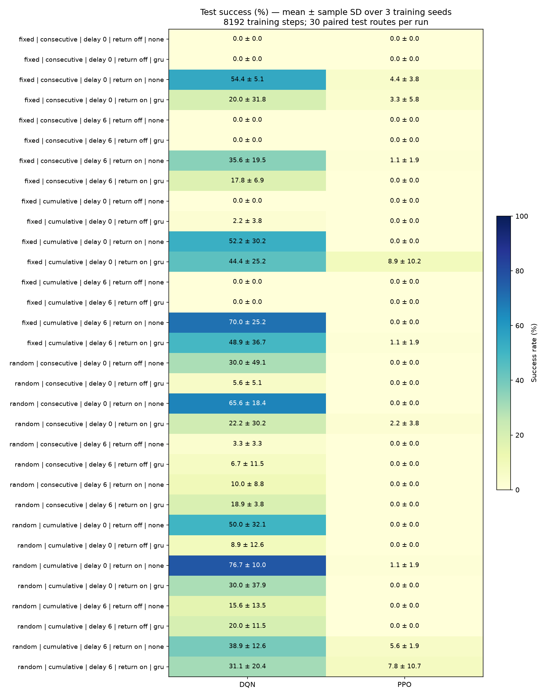

# UAV Path Planning for Dynamic Target Tracking and Sensing

**English** | [简体中文](README.zh-CN.md)

A GridWorld research project combining vehicle motion prediction with Double DQN and PPO-Clip for UAV tracking, sensing, and navigation. Current implementation: November 25, 2026.

## PPO and DQN training

Both algorithms read the same hidden-layer configuration, defaulting to three layers of 128 units. PPO uses Tanh and DQN uses LeakyReLU by default. PPO has independent Actor and Critic networks, full-rollout updates, GAE, masked categorical actions, and KL early stopping for the Actor. Actor and Critic update limits are independently configurable and default to 80.

Use equal environment-step budgets and a validation interval divisible by the PPO rollout length for comparisons:

```powershell
python train.py --algorithm ppo --no-motion-prediction --total-steps 204800 --rollout-steps 1024 --eval-every-steps 10240 --train-pi-iters 80 --train-v-iters 80 --output-dir outputs/ppo
python train.py --algorithm dqn --no-motion-prediction --total-steps 204800 --rollout-steps 1024 --eval-every-steps 10240 --output-dir outputs/dqn
python evaluate.py --policy ppo --checkpoint outputs/ppo/best_model.pt --output-dir outputs/ppo_test
python demo.py --policy ppo --checkpoint outputs/ppo/best_model.pt --no-gif --output-dir outputs/ppo_demo
```

- `--hidden-sizes`, `--activation`, and `--leaky-relu-slope` configure the networks. An explicit activation overrides the algorithm default.
- `--total-steps` takes precedence over the episode budget. The default step-based validation interval is ten rollout lengths.
- The test set is declared before training with `--test-seed` and `--test-episodes`, defaulting to [3000000, 3000100). Evaluation reads this range from new checkpoints and checks separation from the full training run, validation, and predictor data.
- `run_metadata.json` and checkpoint metadata distinguish the selected model's progress from the complete run's training-seed range. Final testing of new run-aware checkpoints requires a completed run.
- `parameter_counts.json` reports policy/value network parameters. `updates.csv` records each PPO update, including pre/post Critic MSE, pre-update explained variance, final KL, entropy, clipping fraction, and actual Actor/Critic update counts. Explained variance is NaN for constant targets.
- Checkpoints restore policies for inference. Exact training continuation requires additional optimizer, random-state, and rollout data.
- `deploy.Policy` automatically recognizes DQN and PPO checkpoints.

## Three-seed GPU integration matrix

The November 25 matrix covers 64 primary configurations: algorithm (DQN/PPO), route (fixed/random), sensing (consecutive/cumulative), observation delay (0/6), automatic return (off/on), and prediction (off/GRU). Each has three training seeds, 42, 10042, and 20042. Eight additional configurations exercise VAR/RNN/LSTM/TCN on both algorithms with random routes, cumulative sensing, delay 6, and automatic return.

Every run uses 8192 environment steps, three 128-unit hidden layers, reward_v2, and zero movement penalty. Validation uses 10 fixed routes at the final step, an integer multiple of the 1024-step rollout. Testing uses the same 30 held-out routes [6000000, 6000030) for every run. This is one validation checkpoint per run. Both algorithms receive the same pretrained predictor checkpoint within each paired condition and training seed.

Predictors use 100 routes with an 80/10/10 split and two fitting epochs, with 64 hidden units and a 32-unit head. The predictor fits are deliberately short. Neural predictor fitting and RL training use CUDA; online forecasts and final evaluation use CPU. Six independent training subprocesses share the GPU. The VAR fit uses CPU least squares.

Reproduce the matrix and export per-seed, aggregate, and per-test-episode results:

```powershell
$env:MKL_THREADING_LAYER = "SEQUENTIAL"
python run_ppo_dqn_matrix.py --root outputs/ppo_dqn_matrix_20261125_8192 --prepare
python run_ppo_dqn_matrix.py --root outputs/ppo_dqn_matrix_20261125_8192 --steps 8192 --workers 6
python run_ppo_dqn_matrix.py --root outputs/ppo_dqn_matrix_20261125_8192 --summarize results/ppo_dqn_20261125
```

This short-budget matrix measures integration reliability and early learning. Convergence and an algorithm ranking require longer runs and balanced hyperparameter tuning. Reported variability is the sample standard deviation across three training seeds; the repeated test routes are paired across runs.

PPO performs eight rollout updates per run. DQN retains its 60000-step exploration schedule, so training epsilon is still about 0.87 at the end (evaluation is greedy). Equal environment steps do not imply equal gradient updates or compute. These settings were held fixed across the matrix, without tuning against its test results.

### Recorded results

All 216 runs completed: 1,769,472 training environment steps and 6480 test episodes. The test episodes reuse 30 paired route seeds, rather than representing 6480 independent routes. Budget, seed-range, checkpoint metadata, and paired predictor-hash checks passed. All 864 PPO updates had finite monitored losses/KL/entropy/clipping metrics, and Critic MSE decreased after every update. Pre-update explained variance had a median of about 0.000047, so decreasing training loss does not establish useful value prediction.

The table below covers the additional-predictor comparison scenario: random routes, cumulative sensing, delay 6, automatic return enabled. Success is mean ± sample SD across three seeds; sensing columns show the mean. In this short run, DQN achieved higher task success; most PPO configurations had little or no task success. Neither method's convergence is established.

| Predictor | DQN success | PPO success | DQN sensing | PPO sensing |
|---|---:|---:|---:|---:|
| none | 38.9 ± 12.6% | 5.6 ± 1.9% | 42.2% | 6.7% |
| var | 50.0 ± 20.8% | 5.6 ± 6.9% | 56.7% | 5.6% |
| rnn | 32.2 ± 13.9% | 1.1 ± 1.9% | 32.2% | 1.1% |
| lstm | 34.4 ± 15.8% | 0.0 ± 0.0% | 37.8% | 0.0% |
| gru | 31.1 ± 20.4% | 7.8 ± 10.7% | 36.7% | 8.9% |
| tcn | 45.6 ± 22.2% | 0.0 ± 0.0% | 48.9% | 0.0% |

Primary matrix (32 conditions × 2 algorithms):



[All 72 configuration summaries](results/ppo_dqn_20261125/summary.csv) · [216 per-seed results and run metadata](results/ppo_dqn_20261125/runs.csv) · [Test episodes](results/ppo_dqn_20261125/test_episodes.csv) · [PPO update diagnostics](results/ppo_dqn_20261125/ppo_updates.csv) · [Protocol, parameter counts, and source hashes](results/ppo_dqn_20261125/protocol.json).

Without prediction features, DQN optimizes 37,649 parameters (75,298 including its target network); PPO optimizes 73,234 (Actor 37,649 + Critic 35,585). With prediction features, these totals are 38,417 / 76,834 for DQN and 74,770 for PPO. Predictor parameters are separate. Raw checkpoints and logs remain under the local experiment output directory.

## Current behavior

- A 50×50 obstacle-free grid by default, with 17 UAV actions: hover and eight directions at two step sizes.
- Fixed or randomly generated vehicle routes, delayed position reports, and consecutive or cumulative sensing.
- Vehicle observations contain received history as `car_history=((measurement_time, (x, y)), …)`. No explicit vehicle displacement is passed to the policy. Before the first report, history is empty and `has_observation=False`.
- Default policy observations have 18 dimensions; three predicted positions add six features. UAV state and sensing progress remain available.
- RNN, LSTM, and GRU predictors share a single implementation. Default architecture: input `(x,y,time)` → one 256-unit recurrent layer → Linear(256,128) → ReLU → Linear(128,2).
- The original MLP, greedy pursuit, motion extrapolation, predictive planning, and Oracle heuristic remain in the codebase. MLP and extrapolation infer motion from received history.

## Route data and training

The predictor uses 1,000 route seeds by default (`100000..100999`), shuffled into 800 training, 100 validation, and 100 test seeds before route generation. Each sample is a complete route, including stationary frames; there are no sliding windows. Routes are regenerated on demand, without storing all trajectories.

Training uses batches of 32 complete routes, retains the final partial batch, and shuffles training routes. At each timestep a unidirectional network predicts the next position. Validation selects the best checkpoint using normalized one-step position MSE. The predictor test group is reserved and is not automatically evaluated by the training entrypoint. Multi-step rollout accuracy and downstream task performance require separate evaluation.

The total predictor route count is independent of DQN episode count. Its seed range must not overlap DQN training/validation or final system evaluation routes. `config.json` records configuration; `prediction_metrics.json` records actual seed groups, training settings, and validation MSE.

## Install and run

Install a PyTorch build appropriate for the target machine, then install project dependencies:

```powershell
python -m pip install -r requirements.txt
python train.py --prediction-model-type lstm --prediction-learning-rate 0.001 --prediction-batch-size 32 --prediction-device auto --observation-delay 3 --output-dir outputs/lstm
python evaluate.py --checkpoint outputs/lstm/best_model.pt --policy dqn --episodes 100 --output-dir outputs/test_lstm
python demo.py --checkpoint outputs/lstm/best_model.pt --policy dqn --output-dir outputs/demo_lstm
```

Change `--prediction-model-type` to `rnn` or `gru` for comparisons. All predictor options are independent of DQN settings:

| Option | Default | Meaning |
|---|---|---|
| `--prediction-routes` | 1000 | Total routes across the three groups |
| `--prediction-seed` | 100000 | First route seed |
| `--prediction-split-seed` | 42 | Seed controlling group assignment |
| `--prediction-learning-rate` | 0.001 | Adam learning rate |
| `--prediction-batch-size` | 32 | Complete routes per batch |
| `--prediction-device` | auto | Prefer CUDA, otherwise CPU; explicit cpu/cuda also supported |
| `--prediction-hidden-size` | 256 | Recurrent width |
| `--prediction-head-size` | 128 | Output-head hidden width |
| `--prediction-num-layers` | 1 | Recurrent depth |
| `--prediction-epochs` | 20 | Predictor training epochs |
| `--prediction-steps` | 4 8 12 | Forecast offsets from the current decision time |

RL device selection remains separate (`--device`, default CPU). `--no-motion-prediction` disables forecast features; `--policy predictive` selects predictive planning in evaluation/demo. Forecasting adds report age to requested horizons exactly once. Outputs are stored under `outputs/`.

## Code map

| File | Responsibility |
|---|---|
| `uav_demo/prediction_data.py` | Seed splits and complete-route generation |
| `uav_demo/sequence_prediction.py` | Networks, route batching, training, rollout, serialization |
| `uav_demo/prediction.py` | Original MLP and shared forecast adapter |
| `uav_demo/environment.py`, `observation.py` | Delayed observations and feature encoding |
| `uav_demo/config.py`, `train.py` | Configuration, seed checks, training entrypoint |
| `uav_demo/agent.py` | Double DQN, shared observation encoding, and predictor loading |
| `uav_demo/ppo.py`, `ppo_model.py` | PPO rollout, GAE, Actor/Critic updates, and checkpoints |
| `evaluate.py`, `demo.py` | Evaluation and visualization |
| `deploy/policy.py` | Simulator-facing policy and report builder |

## Compatibility and validation

DQN checkpoint format is **v9** and PPO format is **v2**. The PPO loader also restores the earlier fixed 64/64 Tanh architecture. Bundled legacy deployment weights and reference results predate these comparisons. The three-seed matrix above is a short-budget integration experiment. CUDA execution was verified with PyTorch 2.14.0+cu130 on an NVIDIA GeForce RTX 5090 D.

Tests can be run explicitly with `python -m unittest discover -s tests -q`. All 115 regression tests passed before the matrix run.

Historical experiment details: [local experiment notes](README_LOCAL.md). The November 4 fixed-route results predate the current sequence models and should not be attributed to them. [Deployment guide](deploy/README.md) · [Original project plan and team assignments (Chinese)](PROJECT_PLAN.md).
