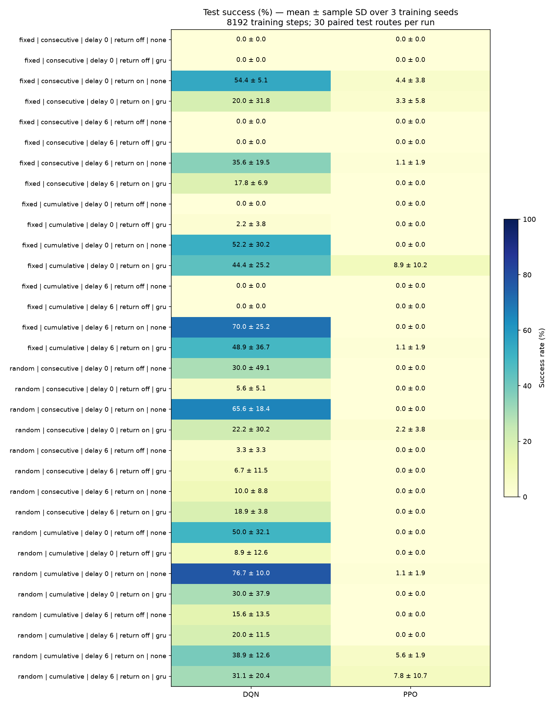

# 动态目标跟踪与感知的无人机路径规划

[English](README.md) | **简体中文**

## 当前实现与进展（2026-11-25）

本仓库已实现无障碍 GridWorld、Double DQN、PPO-Clip、车辆运动预测器、贪心追踪、外推追踪、预测拦截规划器与 Oracle 启发式对照。现已接入 RNN、LSTM、GRU 完整路线序列预测；原始规划及团队分工见 [PROJECT_PLAN.md](PROJECT_PLAN.md)。

### PPO 与 DQN 对照训练

两种算法共用隐藏层配置，默认三层、每层 128 单元。PPO 默认使用 Tanh，DQN 默认使用 LeakyReLU。PPO 的 Actor 和 Critic 各自拥有独立网络，采用整批更新、GAE 和合法动作掩码；Actor 可以因 KL 提前停止。两者的最大更新次数分别由 `--train-pi-iters` 和 `--train-v-iters` 控制，默认均为 80。

```powershell
python train.py --algorithm ppo --no-motion-prediction --total-steps 204800 --rollout-steps 1024 --eval-every-steps 10240 --output-dir outputs/ppo
python train.py --algorithm dqn --no-motion-prediction --total-steps 204800 --rollout-steps 1024 --eval-every-steps 10240 --output-dir outputs/dqn
python evaluate.py --policy ppo --checkpoint outputs/ppo/best_model.pt --output-dir outputs/ppo_test
python demo.py --policy ppo --checkpoint outputs/ppo/best_model.pt --no-gif --output-dir outputs/ppo_demo
```

- `--total-steps` 覆盖按回合数停止的设置，验证间隔必须是 rollout 长度的整数倍，默认取 10 倍。
- 使用 `--test-seed` 和 `--test-episodes` 在训练前固定测试范围，默认 [3000000, 3000100)。最终测试读取 checkpoint 中的范围，并检查与整次训练、验证和预测器数据的隔离。
- `run_metadata.json` 和 checkpoint 分别保存模型选中进度及整次运行的训练种子范围。训练完成后补全范围，再进行最终测试。
- `updates.csv` 每次 PPO 更新写一行，包含 Critic 更新前后 MSE、更新前解释方差、最终 KL、熵、裁剪比例和实际更新次数。目标回报方差为零时，解释方差记为 NaN。
- `parameter_counts.json` 记录策略/价值网络的参数量。checkpoint 用于推理恢复，精确断点续训还需要优化器、随机状态和未完成 rollout。
- 部署的 `Policy` 自动识别 DQN/PPO。DQN 格式为 v9，PPO 为 v2，PPO 加载器兼容早期两层 64 单元 Tanh 模型。

### 三种子 GPU 组合实验

2026-11-25 的主矩阵覆盖 64 种配置，每种运行 3 个训练种子（42、10042、20042），共 192 次训练。组合维度包括算法（DQN/PPO）、路线（固定/随机）、采集（连续/累计）、延迟（0/6）、自动返程（关/开）、预测（关闭/GRU）。另增加 8 种配置，在随机路线、累计采集、延迟 6、自动返程开启的场景下测试 VAR/RNN/LSTM/TCN 与两种算法，共计 216 次训练。

各次训练统一为 8192 个环境步，隐藏层均为 128×3，使用 reward_v2、movement_penalty=0。在最后一步使用 10 条固定验证路线选模，验证间隔为 rollout 长度 1024 的整数倍；每次只产生一个验证时刻。最终测试统一使用 [6000000, 6000030) 的 30 条路线。相同配置和训练种子下，两种算法使用字节一致的预测器 checkpoint。

预测器使用 100 条路线按 80/10/10 划分，训练 2 个 epoch，隐藏层宽度 64、输出头宽度 32。神经预测器拟合及强化学习训练使用 GPU，在线预测和最终评估使用 CPU；6 个训练子进程共享 GPU，VAR 使用 CPU 最小二乘拟合。

```powershell
$env:MKL_THREADING_LAYER = "SEQUENTIAL"
python run_ppo_dqn_matrix.py --root outputs/ppo_dqn_matrix_20261125_8192 --prepare
python run_ppo_dqn_matrix.py --root outputs/ppo_dqn_matrix_20261125_8192 --steps 8192 --workers 6
python run_ppo_dqn_matrix.py --root outputs/ppo_dqn_matrix_20261125_8192 --summarize results/ppo_dqn_20261125
```

该预算用于组合运行验证和早期学习比较，预测器也仅进行了短训练。算法收敛和最终优劣仍需更长预算及同等调参投入。汇总采用三个训练种子的均值与样本标准差，共用测试路线支持配对比较。

PPO 每次训练进行 8 次 rollout 更新；DQN 保留 60000 步探索衰减，训练结束时 epsilon 仍约为 0.87（评估采用贪心动作）。环境步数相同并不表示梯度更新次数或计算量相同。本次统一保留这些设置，没有根据测试成绩修改超参数。

### 本次结果

216 次运行全部完成，共 1,769,472 个训练环境步、6480 次测试回合。测试复用相同的 30 个路线种子，不能视为 6480 条独立路线。训练预算、种子范围、checkpoint 元信息及配对预测器哈希校验通过。864 次 PPO 更新的损失、KL、熵和裁剪比例均为有限数，每次 Critic 更新后的 MSE 都下降；但更新前解释方差的中位数仅约 0.000047，训练损失下降不能证明价值估计已经有效。

下表固定为“随机路线＋累计采集＋延迟 6＋自动返程开启”，覆盖所有本次测试的预测器。成功率为三个种子的均值 ± 样本标准差，采集完成率列为均值。本轮短预算下 DQN 的任务成功率更高；PPO 多数组合仍很少或未能完成任务，尚不能据此判断算法收敛后的优劣。

| 预测器 | DQN 成功率 | PPO 成功率 | DQN 采集完成率 | PPO 采集完成率 |
|---|---:|---:|---:|---:|
| none | 38.9 ± 12.6% | 5.6 ± 1.9% | 42.2% | 6.7% |
| var | 50.0 ± 20.8% | 5.6 ± 6.9% | 56.7% | 5.6% |
| rnn | 32.2 ± 13.9% | 1.1 ± 1.9% | 32.2% | 1.1% |
| lstm | 34.4 ± 15.8% | 0.0 ± 0.0% | 37.8% | 0.0% |
| gru | 31.1 ± 20.4% | 7.8 ± 10.7% | 36.7% | 8.9% |
| tcn | 45.6 ± 22.2% | 0.0 ± 0.0% | 48.9% | 0.0% |

主矩阵（32 种环境/预测条件 × 2 种算法）：



完整数据：[72 组均值与标准差](results/ppo_dqn_20261125/summary.csv) · [216 次逐种子结果及运行元信息](results/ppo_dqn_20261125/runs.csv) · [逐测试回合数据](results/ppo_dqn_20261125/test_episodes.csv) · [PPO 更新指标](results/ppo_dqn_20261125/ppo_updates.csv) · [实验配置、参数量及代码哈希](results/ppo_dqn_20261125/protocol.json)。

关闭预测时，DQN 优化参数 37,649 个，含目标网络共保存 75,298 个；PPO 优化参数 73,234 个（Actor 37,649＋Critic 35,585）。加入预测特征后，DQN 分别为 38,417 / 76,834，PPO 为 74,770。以上不含预测器参数。完整 checkpoint 与训练日志保存在本地实验输出目录。

### 环境与信息边界

- 默认地图 50×50，UAV 支持悬停及八方向、两档步长，共 17 个动作。支持连续和累计采集；完成采集并到达 UAV 终点才算成功。
- `reset()` / `step()` 返回原始单位的 dict。车辆终点和未来轨迹不进入普通策略观测；`info` 和回放文件中的真值仅供评估与可视化。
- 首次报告前，`has_observation=False`，`car_pos=None`，`car_history=()`。延迟为 3 时，t=3 才收到车辆 t=0 的位置。
- `--car-route fixed` 为默认固定起终点路线；`random` 使用随机起点、目的地，并在到达后更换目的地。隐藏字段不等于消除可学习的路线先验。

### 观测、预测与策略

| 位置 | 作用 |
|---|---|
| `uav_demo/environment.py` | 维护真实状态，生成延迟且不泄露终点的观测 |
| `uav_demo/observation.py` | 归一化、按字段顺序编码；支持可选 `rule_action` 特征 |
| `uav_demo/config.py`、`train.py` | 通过 `observation_features` / `--observation-features` 选择特征，按编码结果推导网络维数 |
| `uav_demo/prediction.py` | `forecast_vehicle()` 用 `age + h` 对齐预测时距，以报告时刻对齐车辆移动时钟 |
| `uav_demo/agent.py` | Double DQN、共享观测编码、预测特征及配置保存加载 |
| `uav_demo/ppo.py`、`ppo_model.py` | PPO 轨迹收集、GAE、Actor/Critic 更新及 checkpoint |
| `uav_demo/predictive_planner.py` | 连续预测序列上的会合规划，记录当次实际预测 |
| `evaluate.py`、`demo.py` | 独立评估、首次报告指标、逐步观测与预测记录、PNG/GIF 回放 |
| `compare_delay.py` | 不同报告延迟下的策略比较 |

默认基础输入为 18 维（已移除车辆位移两维），三个预测点增加 6 维。`--prediction-steps 4 8 12` 表示相对当前时刻的预测偏移，而非相对历史报告时刻；没有报告时不调用预测器。经验回放仍保存数值数组，checkpoint 保存特征名称和顺序。

车辆观测提供 `car_history=((报告时间, (x, y)), …)`，只含已收到的报告，保留停顿帧；时间为测量时刻。MLP 和外推规则从历史报告推导最近运动，DQN 不直接接收位移。DQN checkpoint 版本为 9，PPO 为 2，旧 DQN 权重需要重新训练。

序列预测器支持 RNN/LSTM/GRU，默认采用单层 256 维循环网络和 `Linear(256,128) → ReLU → Linear(128,2)` 输出头。每批 32 条完整路线，默认学习率 0.001；`prediction_device=auto` 优先 CUDA，不可用时使用 CPU。DQN 的 `--device`、`--batch-size` 与预测器配置独立。

```powershell
python train.py --prediction-model-type lstm --prediction-learning-rate 0.001 --prediction-batch-size 32 --prediction-device auto --prediction-hidden-size 256 --prediction-head-size 128 --prediction-routes 1000 --prediction-seed 100000 --output-dir outputs/lstm
```

预测器总路线数不再受 DQN 回合数限制。默认种子 `100000..100999` 按 800/100/100 分成训练、验证、测试；`--prediction-split-seed` 控制分组。整个预测器种子区间与 DQN 训练/验证及最终系统测试分开。每个 epoch 按需生成路线，训练时打乱路线顺序、不切窗口、不丢尾批。`config.json` 保存配置，`prediction_metrics.json` 保存实际分组、训练设置和最佳验证一步位置 MSE；预测器测试组不用于选模型。

另外支持外推规则先验（`--rule-prior`，需选择 `rule_action` 特征）和采集结束后自动返航（`--auto-return`）。这些设置改变策略行为，比较实验时应显式记录；默认不开启。

### 安装与运行

在项目根目录执行（Python 环境需安装 PyTorch）：

```powershell
python -m pip install -r requirements.txt
python train.py --episodes 1500 --observation-delay 3 --output-dir outputs/train_delay3
python evaluate.py --checkpoint outputs/train_delay3/best_model.pt --policy dqn --episodes 100 --output-dir outputs/test_delay3
python demo.py --checkpoint outputs/train_delay3/best_model.pt --policy dqn --output-dir outputs/demo_delay3
```

评估和演示的 `--policy predictive` 可切换为预测拦截规划器，需要模型包含车辆预测器。`--no-motion-prediction` 关闭策略的预测附加输入，`--no-gif` 可用于 demo 只生成静态图。模型、日志和动画保存在 `outputs/`，该目录不上传 GitHub。

### 已完成的实验

2026-11-04 的 15×15 固定路线实验：报告延迟 3 步，完整默认特征，DQN 训练 1,500 回合，预测器使用 300 条路线训练 20 个 epoch。验证集选出第 1,200 回合模型，在 100 条独立测试路线上，DQN 成功率 **95%**，预测规划器 **59%**。

这些结果对应当时的固定路线、无规则先验实验，不代表后续随机路线或其他延迟配置的表现。最后一轮验证成功率降至 43.3%，训练仍有波动，尚需多种子与消融验证。具体配置与复现命令见 [README_LOCAL.md](README_LOCAL.md)；原始结果位于本地 `outputs/dict_train_1500_20261104/`。


## 预测器独立配置

| 参数 | 默认值 | 作用 |
|---|---|---|
| `--prediction-model-type` | lstm | rnn / lstm / gru |
| `--prediction-routes` | 1000 | 三组路线总数 |
| `--prediction-seed` | 100000 | 路线种子起点 |
| `--prediction-split-seed` | 42 | 分组随机种子 |
| `--prediction-learning-rate` | 0.001 | Adam 学习率 |
| `--prediction-batch-size` | 32 | 每批完整路线数 |
| `--prediction-device` | auto | 优先 CUDA，无 CUDA 则 CPU；支持显式 cpu/cuda |
| `--prediction-hidden-size` | 256 | 循环层宽度 |
| `--prediction-head-size` | 128 | 输出头隐藏宽度 |
| `--prediction-num-layers` | 1 | 循环层数 |
| `--prediction-epochs` | 20 | 预测器训练轮数 |
| `--prediction-steps` | 4 8 12 | 相对决策时刻的预测偏移 |

DQN 的 `--device` 默认仍为 CPU。每批保留完整路线，尾批损失按路线数加权。单向循环网络在每个时刻预测下一步位置，递归推理期间使用预测位置推进。训练入口按验证一步 MSE 选模型，不自动评估预测器测试组；延迟多步误差及下游任务表现需另行评估。

代码入口：`prediction_data.py` 负责完整路线生成，`sequence_prediction.py` 负责网络、batch、训练和递归预测，`prediction.py` 提供统一预测适配，`agent.py` 按模型类型加载权重，`evaluate.py` 检查最终系统测试种子边界。

## 验证与兼容性

DQN checkpoint 为 v9，PPO 为 v2；部署目录中的历史模型及参考结果早于当前实现。新版组合实验属于短预算测试，长期收敛仍需单独验证。

需要时可执行 `python -m unittest discover -s tests -q`。本次完整回归测试 115 项通过。上述历史实验结果早于当前序列模型，不能作为新版结果。另见 [部署说明](deploy/README.md)。

本次在 NVIDIA GeForce RTX 5090 D、PyTorch 2.14.0+cu130 上验证 CUDA 训练。组合实验前完整回归测试 115 项通过。
