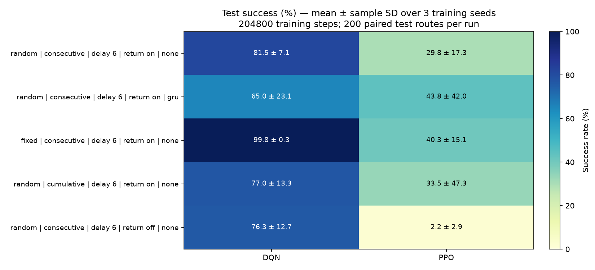
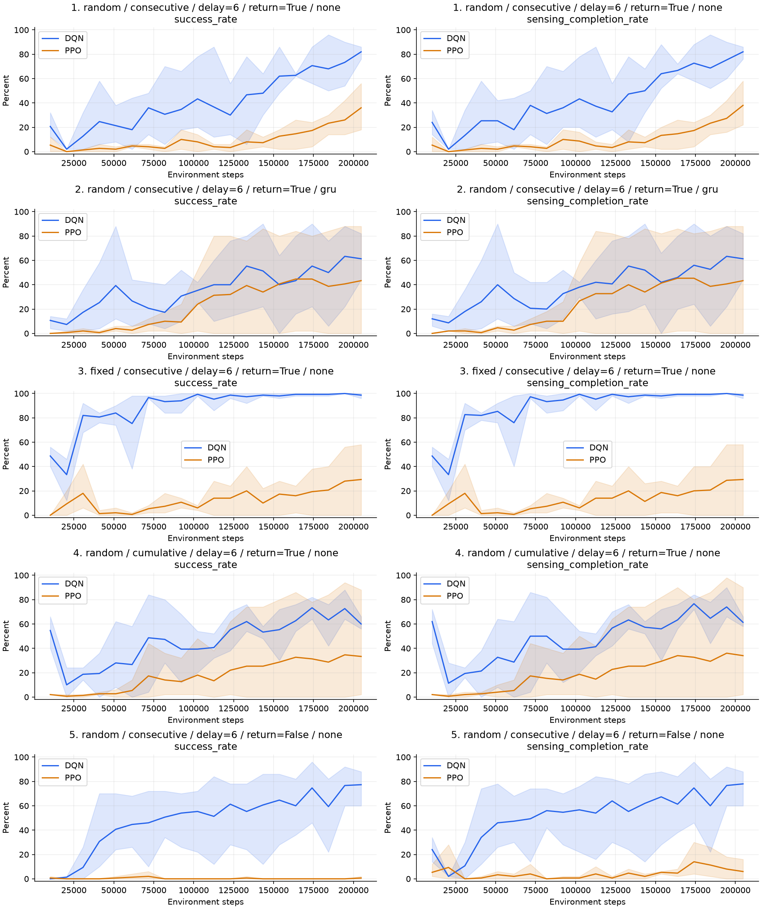
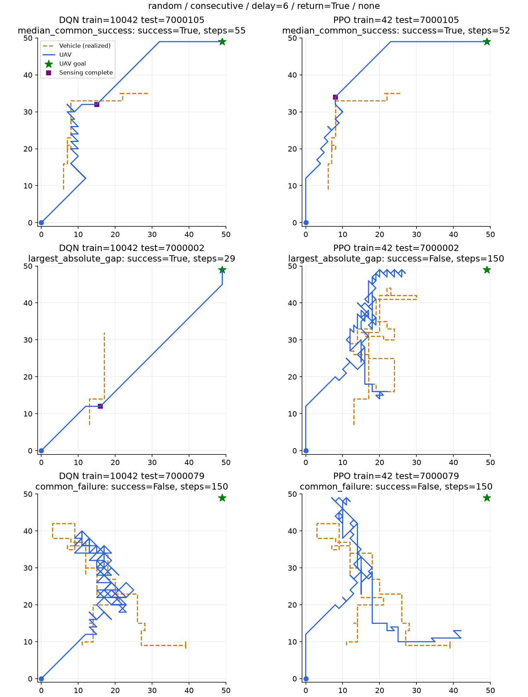

# PPO / DQN：64×3 网络实验总结

2026-11-25。在约 1.5 小时预算内完成 5 个代表性场景、两种算法、各 3 个训练种子的比较。**当前配置和采样预算下，DQN 在这五个场景的平均成功率均高于 PPO；PPO 的种子差异较大，不能据此判断两类算法的性能上限。**

## 实验设置

- 共 **30 次训练**，每次 **204800 个环境步**，合计 **614.4 万步**；最终测试共 **6000 回合**。
- DQN、PPO Actor 和 Critic 均采用 **3 个隐藏层，每层 64 单元**。DQN 使用 LeakyReLU，PPO 使用 Tanh，Actor/Critic 网络独立。
- 基准场景：50×50 地图、随机车辆路线、连续采集、观测延迟 6 步、自动返程、无预测；其余场景分别只改变一个因素。
- 训练种子为 **42 / 10042 / 20042**。每 10240 步使用固定 50 个验证种子选模；最终在独立的 200 个测试种子 `[7000000, 7000200)` 上评估。两种算法在同一场景中使用相同车辆路线，fixed 与 random 的路线分布不同。
- 验证和测试使用合法动作中的贪心选择，PPO 取概率最大的动作。预测器采用旧实验已训练好的冻结 GRU，1000 条路线、30 个 epoch，预测偏移为 `(0, 1, 4)`；配对算法使用相同权重。
- RTX 5090 D 上最多 12 个训练进程并行；在线预测和最终评估使用 CPU。训练与测试耗时 **87.8 分钟**，报告检查完成时总计 **89.4 分钟**。

## 测试结果

成功率为三个训练种子的均值 ± 样本标准差，`pp` 表示百分点。完成步数先对每个种子的 200 回合取均值，再对三个种子平均；**失败回合按 150 步计**，避免把快速失败误当成高效率。所有场景的延迟均为 6 步。

| 场景 | DQN 成功率 | PPO 成功率 | DQN 完成步数 | PPO 完成步数 |
|---|---:|---:|---:|---:|
| 随机路线、连续采集、自动返程（基准） | 81.5% ± 7.1pp | 29.8% ± 17.3pp | 66.10 | 123.98 |
| 基准 + GRU 预测 | 65.0% ± 23.1pp | 43.8% ± 42.0pp | 86.89 | 108.81 |
| 改为固定路线 | 99.8% ± 0.3pp | 40.3% ± 15.1pp | 55.39 | 138.51 |
| 改为累计采集 | 77.0% ± 13.3pp | 33.5% ± 47.3pp | 72.61 | 118.97 |
| 关闭自动返程 | 76.3% ± 12.7pp | 2.2% ± 2.9pp | 70.41 | 148.85 |

## 主要观察

1. **DQN 基准达到 81.5%。** 相比上轮 8192 步短测试，长训练得到了更有意义的结果。它接近旧实验约 82% 的成绩，但网络大小、训练种子、预算和测试集并非完全相同，不能视为严格复现，也不能把差异全部归因于训练量。
2. **PPO 对种子明显敏感。** GRU＋PPO 按种子 42 / 10042 / 20042 的成功率分别为 **41.5% / 3.0% / 87.0%**；累计采集 PPO 分别为 **10.0% / 2.5% / 88.0%**。单独展示最好的一次运行会掩盖这种不稳定性。
3. **加入预测器不保证收益。** 本轮 GRU 将 PPO 的均值从 29.8% 提高到 43.8%，但 DQN 的均值从 81.5% 降到 65.0%。这是当前配置下的观察，不是预测器效果的普遍结论。
4. **自动返程影响任务含义。** 开启后，完成采集后的动作受最短返程路线约束；关闭后，策略需要学习完整任务。关闭时 DQN 为 76.3%，PPO 为 2.2%，不能把自动返程开启时的成功率解释为策略独立学会了返程。
5. **Critic 指标不能代替任务成功率。** GRU＋PPO 种子 10042 的末 20 批更新前解释方差中位数约为 0.996，但末轮验证成功率为 0%。准确预测当前策略的回报，不意味着策略已经有效。这组末期指标与最佳 checkpoint 的测试成绩是不同时间点的数据。

## 学习曲线与典型轨迹

曲线为三个种子的均值，阴影表示最小值至最大值。部分曲线末期仍上升或波动，因此本轮不能宣称所有模型都已稳定收敛。

每个场景、每种算法先按验证成绩选中位数训练种子，再从配对测试路线中选择共同成功的中位案例、完成时间差异最大案例和共同失败案例。不存在的类别在完整报告中注明。这些是事后说明性展示，不能替代全部测试结果。

下面展示基准场景：蓝线为 UAV，橙线为车辆实际路径，紫点为采集完成，绿星为 UAV 终点。车辆真值仅用于回放；策略回合结束时间不同，会导致橙线路径长度不同。

其他场景：[GRU](trajectories_2.png) · [固定路线](trajectories_3.png) · [累计采集](trajectories_4.png) · [关闭自动返程](trajectories_5.png)。

差异案例动画：[DQN](replays/case1_largest_absolute_gap_dqn/episode.gif) · [PPO](replays/case1_largest_absolute_gap_ppo/episode.gif)。全部选择依据见 [case_selection.json](case_selection.json)。

## 检查与结论边界

- **115 项回归测试通过**；30 次运行全部完成。训练预算、网络结构、测试种子、运行元信息、配对预测器哈希与冻结权重检查通过。
- 审计 **3000 次 PPO 更新**，受检损失、KL、熵和裁剪比例均为有限数；2997 次 Critic 更新后批内 MSE 下降。批内拟合改善不能替代独立测试。
- 为满足时间预算，在最终测试前删除了尚未开始的零延迟对照；本轮不比较延迟效应。中止的 128×3 运行没有混入结果。
- 这是代表性单因素对照，不是全因子覆盖。仅三个种子，也没有给两种算法做等量超参数搜索；相同步数并不意味着相同参数量、梯度更新次数或计算量。
- 6000 次测试回合复用了固定种子，不能视为 6000 条独立路线。没有根据测试成绩更换种子或追加调参。

## 完整报告与数据

[完整 HTML 报告](report.html)（下载报告目录后本地打开，GitHub 文件页展示源码）包含逐种子成绩、选模与末轮稳定性、全部轨迹及诊断。原始 checkpoint 和训练日志保留在本地 `outputs/ppo_dqn_focused64_20261125/`。

- [配置汇总](summary.csv) · [逐种子结果及参数量](runs.csv) · [6000 回合测试数据](test_episodes.csv)
- [验证曲线数据](validation_curves.csv) · [最佳与末轮验证](checkpoint_stability.csv)
- [PPO 更新指标](ppo_updates.csv) · [Critic 末期诊断](critic_diagnostics.csv)
- [实验配置与代码哈希](protocol.json) · [执行与检查记录](execution.json) · [预先计划及范围调整](PLAN.md)
- [训练脚本](../../run_ppo_dqn_focused.py) · [报告生成脚本](../../report_ppo_dqn_focused.py)
